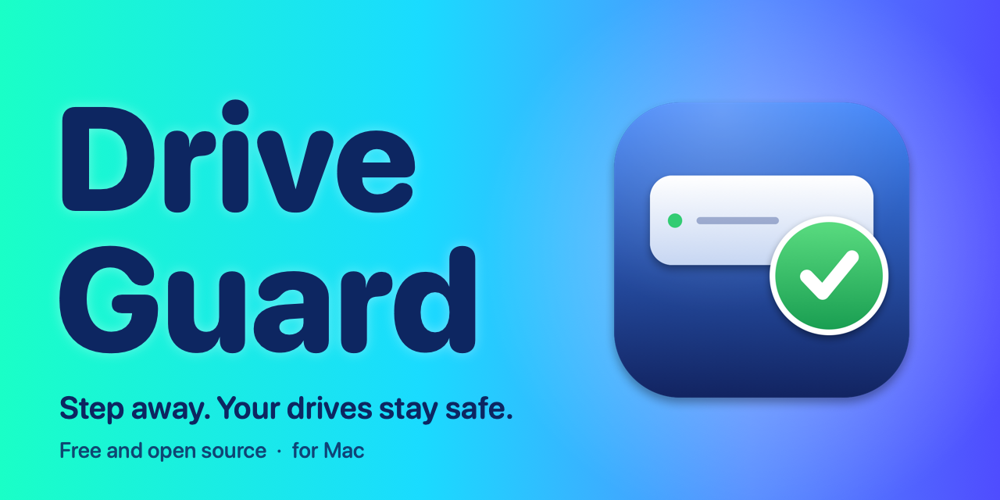

# DriveGuard

**Step away. Your drives stay safe.** A free, open-source menu bar app for the Mac that safely unmounts your external drives when you leave, and mounts them again when you are back.

External drives keep spinning and keep waking a sleeping Mac, and a Time Machine drive that is still mounted when the Mac sleeps can come back with the "Disk Not Ejected Properly" warning. DriveGuard unmounts the drives you choose when you step away, waits for Time Machine first, never forces anything, and remounts them when you return. There is no account to create, no sign-in, and the app makes no network connections of its own.

> **Status: DriveGuard 1.0 is in testing and has not been released yet.** The source is public while it is finished and tried on real drives. The plan is in [Documents/](Documents/). Free and open source under the GNU General Public License v3.

---

## Safety comes first

DriveGuard exists because losing backup data is not an option, so it has hard rules:

- It **never forces** an unmount. If macOS says a drive is busy, DriveGuard retries politely and then leaves the drive mounted.
- It **never ejects**. It only unmounts, so the drive stays connected.
- It **never unmounts while Time Machine is backing up**, or when it cannot tell. It waits and checks again, as long as it takes. Right before the Mac sleeps it cannot wait, so it skips the drive instead.
- It **only touches drives you ticked**. Nothing is unmounted until you choose it. The startup disk, internal drives, network shares and disk images are always left alone.
- It **never holds sleep** longer than your limit (25 seconds at most), and never vetoes it.
- It **always remounts**, when you return, when you quit, and after a crash. (When the Mac shuts down or restarts, macOS unmounts the drives itself and mounts them again at startup.)

---

## Open source

The source code is on GitHub: <https://github.com/vaultstudio-main/DriveGuard>.

DriveGuard is released as free software under the **[GNU General Public License, version 3](LICENSE)**. In plain terms:

- You can read all of the code, run it, change it and share it.
- If you share a changed version, it has to stay open under the same license.
- It stays free for everyone, and nobody can close it up and sell it as their own.

For an app that touches your backup drive, that matters: you can check exactly what it does.

The plans for the first release and what comes after are kept in the open, in [Documents/](Documents/).

---

## What it does

**Unmounts when you step away.** Choose any of these triggers; each can be switched on or off:

| Trigger | When it fires | When the drives come back |
|---|---|---|
| Screen lock | The screen locks | You unlock the screen (always brings everything back) |
| Screen saver | The screen saver starts | The screen saver stops |
| Display sleep | The display goes to sleep | The display wakes |
| User switch | Another user's session becomes active | Your session becomes active again |
| System sleep | Just before the Mac sleeps | The Mac wakes |

Drives come back once every active trigger has ended, so a screen saver stopping while the screen is still locked does not remount anything.

**You pick the drives.** Every drive is off until you tick it. Each drive can have its own delay after a trigger, and its own list of triggers. Time Machine drives are marked.

**Time Machine aware.** Before every unmount it asks Time Machine whether a backup is running, and waits if one is (or if it cannot tell). You choose how often it checks again, from 15 to 120 seconds.

**Encrypted drives.** macOS locks an encrypted drive when it is unmounted, and only its password opens it again. DriveGuard leaves an encrypted drive alone until you save its password in the drive's settings. The password is kept in your own Mac keychain, checked with macOS when you save it, and used only to unlock the drive when you return. It is never written to the log, never put on a command line and never sent anywhere. macOS only lets an app unlock drives if you give it **Full Disk Access** (System Settings > Privacy & Security); until you do, DriveGuard does not unmount encrypted drives.

**Gentle with busy drives.** If macOS refuses an unmount because something is using the drive, DriveGuard retries a few times, names the programs holding the drive open in the activity log, then leaves the drive mounted and tells you. It also waits if a program is actively writing to the drive.

**Careful before sleep.** Just before the Mac sleeps it makes a short attempt, retrying a busy drive every 5 seconds, for as long as your hold limit allows, and then lets the Mac sleep.

**In the menu bar.** Unmount or remount from the menu, remount a single drive, pause DriveGuard for an hour or until you resume it, and turn on Launch at login. The icon shows when drives are unmounted or paused.

**Tells you when something fails.** An optional notification when an unmount is refused or a remount fails, and an activity log you can open and export.

**One small window.** The settings window shows the drives, the triggers and the options on one screen, with a status bar for what DriveGuard is doing and what Time Machine is doing. A built-in Help explains everything.

---

## Privacy

- No analytics, no accounts, no advertising, no crash reporting, and nothing about you is sent anywhere.
- The app makes no network connections of its own. The links in About and Help open in your browser only when you click them.
- Your choices (which drives, which triggers, delays and options) are stored on your Mac in the app's own settings, along with the short list of drives it has unmounted and still has to remount.
- The activity log (the last 500 events) is saved in a small file on your Mac, in `~/Library/Application Support/DriveGuard/`, so it survives a quit, a crash or a restart. **Clear** in the log window empties it, and nothing in it is ever sent anywhere.
- If you save the password of an encrypted drive, it is kept in your Mac's own keychain (one entry per drive), and nowhere else. You can remove it at any time in the drive's settings.
- To work safely it asks macOS which drives are mounted, asks Time Machine whether a backup is running, and, if an unmount is refused, lists the programs that have files open on that drive. All of this stays on your Mac.

---

## Requirements

- A Mac running **macOS 15 or later**.
- To build it yourself: **Xcode** (recent version) on a Mac.

DriveGuard runs **without the App Sandbox**, on purpose: to unmount and mount drives and to ask Time Machine for its status, it needs access the sandbox does not allow. That also means it is not made for the Mac App Store, and builds are shared from GitHub.

---

## Building from source

1. Clone this repository.
2. Open `DriveGuard.xcodeproj` in Xcode.
3. Choose the **DriveGuard** scheme and **My Mac**, then Run (⌘R).

You will need to choose your own signing team (and bundle identifier if you plan to distribute your own build) in the project settings.

DriveGuard lives in the menu bar and has no Dock icon until its window is open. If you run it from Xcode and stop it there, drives it has unmounted are remounted the next time it starts.

---

## Where things are

| Folder or file | What is in it |
|---|---|
| `DriveGuard/` | The app's source code |
| `Documents/` | Where the plan files go: the release plan and other planning notes (see [Documents/README.md](Documents/README.md)) |
| `LICENSE` | The GNU General Public License, version 3 |

Inside `DriveGuard/`:

| File | What it does |
|---|---|
| `DriveGuardApp.swift` | The app, its menu bar item, its windows and the Dock icon behavior |
| `DriveGuardController.swift` | The heart of it: triggers, unmount and remount, retries, pause |
| `DiskManager.swift` | Talks to macOS about drives (DiskArbitration): list, unmount, mount |
| `TimeMachine.swift` | Asks `tmutil` whether a backup is running, and which drive is the backup drive |
| `Tools.swift` | Runs command-line tools safely, and finds the programs holding a drive open |
| `PowerMonitor.swift` | Listens for the Mac going to sleep and waking up |
| `AppSettings.swift` | Everything you can set, saved on your Mac |
| `ContentView.swift`, `SettingsViews.swift` | The window |
| `HelpView.swift`, `AboutWindow.swift`, `MenuCommands.swift` | Help, About and the menu bar at the top of the screen |
| `EventLog.swift`, `Notifier.swift`, `LoginItem.swift` | The activity log, notifications and Launch at login |

---

## Contributing

Ideas, bug reports and fixes are welcome. Before starting on something big, have a look at [Documents/](Documents/) to see whether it is already planned, and open an issue to talk it through. Anything you contribute is shared under the same GPL v3 license as the rest of the project.

Please keep to what the app stands for: your data comes first, nothing is ever forced, and anything that touches a drive is deliberate, careful and reversible.

---

## License

DriveGuard is free software: you can redistribute it and change it under the terms of the [GNU General Public License](LICENSE) as published by the Free Software Foundation, version 3 of the License. It is distributed in the hope that it will be useful, but **without any warranty**, without even the implied warranty of merchantability or fitness for a particular purpose. See the license for details, or read it at <https://www.gnu.org/licenses/gpl-3.0.html>.
